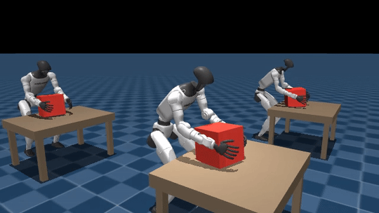

# unitree-g1-humanoid-place

> **Place / drop policy for the Unitree G1 — set a carried box down on a target surface without overshoot or premature release.** PPO fine-tune of a pick-pretrained actor with an asymmetric z-axis reward kernel (broad above, narrow below) that teaches controlled descent instead of a hard cliff.

[](LICENSE)
[](https://www.python.org/downloads/release/python-3100/)
[](https://github.com/google-deepmind/mujoco)
[](https://github.com/mujocolab/mjlab)
[](https://github.com/leggedrobotics/rsl_rl)

<p align="center">
  
</p>
<p align="center"><sub>Grid of 4 rollouts of the trained place policy — G1 setting the carried box down on a target surface with the asymmetric z-kernel reward described below. GIF generated from the latest checkpoint via <code>scripts/make_portfolio_media.py</code>.</sub></p>

## What this does

- Trains a humanoid to **lower a carried box onto a target surface** without overshooting into it or releasing prematurely in mid-air.
- Reuses the pick checkpoint as warm-start — the arm stack and grip pattern transfer directly to place.
- Resets from the **pick terminal-state buffer**, so training starts from a distribution of real already-grasped states (same convention as carry — the two tasks are drop-in interchangeable in an FSM).
- Uses an **asymmetric z-axis reward kernel** around the target surface: broad above the surface (pulls the box down), narrow below (penalises overshoot). Controlled descent instead of a hard cliff.
- Mirrors pick's **hand-lost-grip** penalty into place so the box is not released mid-descent.

## Pipeline position

Final stage of the loco-manipulation pipeline. Shares the pick-buffer convention with carry so an FSM can swap carry↔place without re-tuning.

```
     pick_terminal_states.npz
                │
       ┌────────┴────────┐
       ▼                 ▼
┌────────────┐    ┌────────────┐
│   CARRY    │    │   PLACE    │  ← you are here
└────────────┘    └────────────┘
       │                 │
       └── FSM swap ─────┘  (both consume pick's buffer; same reset schema)
```

## Reproduce

### Quick smoke run (laptop GPU, ~5 min)

```bash
git clone https://github.com/narayanerm/unitree-g1-humanoid-place.git
cd unitree-g1-humanoid-place
uv pip install -r requirements.txt
jupyter lab 01b_place.ipynb
```

Set `DEBUG_LIGHT = True` in the first cell and Run All.

### Full training (B300-class GPU, ~3–5 h)

Leave `DEBUG_LIGHT = False`. Flags: `REUSE_TRAINING`, `RESUME`, `WARM_START_FROM_PICK`, `DEBUG_LIGHT`.

### Inspect

```bash
python view.py                       # viser at http://localhost:8080
tensorboard --logdir outputs/logs/g1_drop
```

## Technology stack

| Component           | Choice                                                                              |
| ------------------- | ----------------------------------------------------------------------------------- |
| Physics simulator   | MuJoCo Warp (GPU-parallel) via **mjlab**                                            |
| RL algorithm        | PPO (`rsl_rl`), adaptive LR, GAE(λ=0.95), clip=0.2                                  |
| Policy architecture | 3-layer MLP (512→256→128, ELU), observation normalisation                           |
| Observation         | Proprioception + box pose + target pose (body-yaw frame)                            |
| Action              | 29 D joint position targets                                                         |
| Transfer learning   | Pick warm-start (shape-filtered) + progressive layer unfreeze                       |
| Reset event         | Sample from pick terminal buffer                                                    |
| Reward design       | **Asymmetric z-kernel** (broad above target, narrow below) + grip-preservation      |
| Compute target      | 1× NVIDIA B300 SXM6 (tuned); scalable via `src/tiers.py`                            |

## Architecture highlights

- **Asymmetric z-kernel.** A gaussian-above / step-below composite on `box_z - target_z` punishes overshoot asymmetrically. Teaches the policy to brake at the surface rather than fall into it.
- **Buffer convention mirrors carry.** Both repos consume `pick_terminal_states.npz` with identical reset code, so an FSM (see sibling [`fsm`](../unitree-g1-humanoid-fsm)) can swap one for the other without reconfiguring the environment.
- **Grip-preservation inherited from pick.** The hand-lost-grip penalty from pick is enabled here too, with a smaller weight — the policy keeps the symmetric bimanual grip through descent until contact.
- **Single notebook per task.** No variant explosion — place is one task, one notebook, one reward.

## Visual assets

```bash
python scripts/make_portfolio_media.py outputs/media/<place_rollout>.mp4
# writes docs/demo.gif + docs/frame_map.png
```

## Chain

| Repo | Role |
| --- | --- |
| [walk](../unitree-g1-humanoid-walk) | Base locomotion |
| [reach](../unitree-g1-humanoid-reach) | Standing bimanual reach |
| [pick](../unitree-g1-humanoid-pick) | Walk to table + grasp (warm-start source) |
| [carry](../unitree-g1-humanoid-carry) | Walk while carrying (sibling, shared reset schema) |
| **[place](.)** ← you are here | Set the carried box down |
| [fsm](../unitree-g1-humanoid-fsm) | Chain experts into a unified BC dataset |
| [monolithic-policy](../unitree-g1-humanoid-monolithic-policy) | Single MLP end-to-end alternative |

## Citation

```bibtex
@misc{medeiros2026g1place,
  author       = {Ribeiro Medeiros, Narayane},
  title        = {unitree-g1-humanoid-place: place/drop policy for the Unitree G1 in mjlab},
  year         = {2026},
  howpublished = {\url{https://github.com/narayanerm/unitree-g1-humanoid-place}}
}
```

## Author

**Narayane Ribeiro Medeiros** — ITAndroids Humanoid Team, Instituto Tecnológico de Aeronáutica.
[GitHub](https://github.com/narayanerm) · [LinkedIn](https://www.linkedin.com/in/narayanerm) · narayane.rm@gmail.com

Released under the [MIT License](LICENSE).
